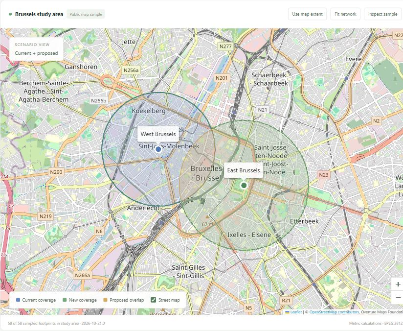
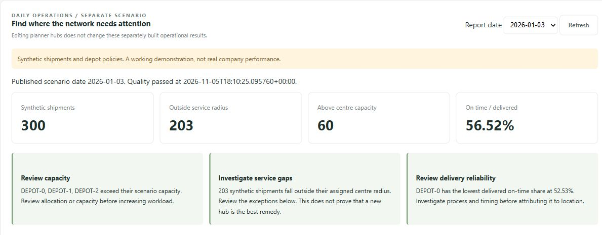

# BelgiFlow

### Service-network planning and operational insight for Belgium

Compare service-hub locations, understand coverage trade-offs, and identify where a network needs attention. BelgiFlow combines an interactive geographic planner with date-based operational reports in a local workspace.



*Current coverage in blue, new coverage in green, and proposed overlap in amber. Captured from the running application using public Brussels map data and fictional hubs.*

## What it helps you do

- **Compare expansion options.** Add, remove or resize hubs and measure newly covered areas, coverage lost elsewhere, overlap and sampled buildings reached.
- **Review workload.** Find centres whose allocated shipment volume exceeds their configured capacity.
- **Investigate service gaps and delays.** Inspect out-of-radius exceptions and compare delivered, on-time and cancelled shipments by centre.
- **Share a traceable result.** Export planning comparisons as CSV or JSON, or download an operational report with its source and quality evidence.

The planner supports preliminary network comparison. It evaluates the alternatives you define rather than automatically choosing an optimal site.

## From a map to a decision

Choose a current network, edit the proposed alternative, and compare both within the same study area. Guided examples demonstrate adding a hub, closing a hub and extending a service radius.

In the public Brussels example, adding an eastern hub increases radius coverage from **6.16 to 13.27 km²**, with **7.11 km² gained**. Closing the western hub still gains coverage in the east but loses **5.22 km²** elsewhere. Showing both gains and losses makes that trade-off visible.

The operational view complements those comparisons with a built daily report:



*These are computed results from 300 synthetic shipments. The panel includes per-centre tables, coverage exceptions, report-date selection and dataset-quality evidence below this summary.*

Operational reports are a separate scenario. Changing planner hubs does not recalculate shipment outcomes. Connecting those workflows is a priority in the [roadmap](ROADMAP.md).

## Quick start

Requires **Python 3.12**. From the repository root, preferably in a virtual environment:

```bash
pip install -r requirements.lock.txt
pip install -e . --no-deps
python -m belgiflow.planner.demo
```

Open **[localhost:8080](http://localhost:8080)**. The command builds the operational report through Dagster and dbt, then starts the complete offline demo. It uses explicitly synthetic geography and operations, requires no API keys, and can take a minute to prepare. Add `--port 8081` if needed.

<details>
<summary>Use real public map data</summary>

Acquire the public reference, build its operational report, and start the planner against the cache:

```bash
python -m belgiflow.platform.cli run --pipeline 01_geographic_reference --date 2026-01-03 --source-mode live
python -m belgiflow.platform.cli run --pipeline 13_operations_dashboard --date 2026-01-03 --source-mode cached
python -m belgiflow.planner.server --source-mode cached
```

Live acquisition discovers a current Overture release and records its provenance. See the [source guide](docs/SOURCES.md) for release pinning, attribution and dataset scope. The README screenshots use release `2026-10-21.0`.

</details>

<details>
<summary>Run the planner, Dagster and Spark with Docker</summary>

With Docker Desktop running and the public cache prepared:

```bash
docker compose --profile ui up -d --build planner dagster spark-worker
```

The planner opens on [port 8080](http://localhost:8080) and Dagster on [port 3000](http://localhost:3000). The Compose planner uses cached geography. For a fresh offline checkout, use the Python demo above. See the [runbook](docs/RUNBOOK.md) for partitions, source modes and service management.

</details>

## Behind the workspace

**15 Dagster jobs** prepare geographic references, ingest synthetic events, maintain depot-policy history, calculate analytical products, check quality and publish reproducible outputs.

| Layer | Tools and responsibilities |
| --- | --- |
| Geographic analysis | Python, Shapely and PyProj for clipping, metric coverage and spatial joins |
| Local data products | Parquet, SQLite, DuckDB and dbt for incremental ingestion and analytical models |
| Orchestration and scale | Dagster, a separate PySpark worker and optional PostgreSQL outbox CDC |
| Optional cloud path | Terraform, S3, Glue, Redshift Serverless, ECS and CloudWatch |

The cloud path is implemented with offline contract checks. It has **not been deployed or validated live on AWS**.

[Architecture diagram](docs/assets/architecture.png) · [Pipeline catalog](docs/PIPELINES.md) · [AWS preparation](docs/AWS.md)

## Scope and development status

The local workspace, exports, dbt workflows, PostgreSQL CDC and Spark processing have been exercised locally. The current verification record contains **54 passing tests** and a clean offline-demo run.

Coverage is a **straight-line radius**, not road travel time. Public validation currently uses the Belgian boundary and a small Brussels building and road sample. Building footprints do not represent customers or demand. Operational records are synthetic. National completeness and production deployment remain future work.

```bash
pip install pytest==9.2.0
python -m pytest tests -q
```

The optional PostgreSQL integration test uses `BELGIFLOW_TEST_DSN` pointing to a disposable test database. See [verification details](docs/VERIFICATION.md) for checks and execution boundaries.

Next priorities are connecting proposed networks to operational impact, expanding geographic coverage, and improving saved-scenario workflows. See the [development roadmap](ROADMAP.md).

## Documentation

[Planner guide](docs/PLANNER.md) · [Data sources](docs/SOURCES.md) · [Pipeline contracts](docs/PIPELINES.md) · [Runbook](docs/RUNBOOK.md) · [Roadmap](ROADMAP.md)

## License and attribution

Created and personally maintained by **Adel (Adelapt98)**. The product contains no AI functionality.

Original software is [MIT licensed](LICENSE). Public datasets and third-party assets retain their own licenses and attribution requirements. See [asset credits](docs/assets/ASSETS.md).
