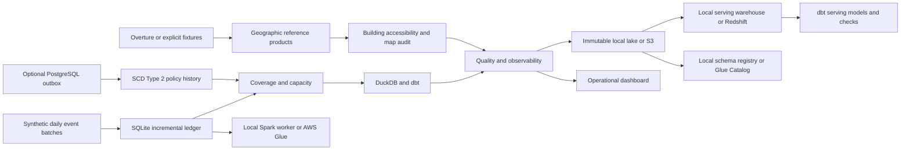

# BelgiFlow

BelgiFlow is a Belgian logistics data engineering learning platform. It uses public map data and synthetic operational records to answer concrete questions about delivery coverage, depot workload, delivery reliability, and the quality of the data behind those decisions.

The repository is intended for developers learning to build and operate connected batch data products. Each pipeline has its own business purpose, output, and engineering concepts. The same project supports a fully local execution path and an optional AWS implementation.

Original software is personally maintained by Adel (Adelapt98). The product contains no AI functionality and processes no real customers, drivers, or shipment histories.

## Purpose

- Explain which synthetic shipments fall outside the depot policy effective when they were created.
- Identify overloaded depots and distinguish capacity problems from geographic coverage problems.
- Measure delivery SLA outcomes without counting cancellations as successful deliveries.
- Analyze building distance to sampled roads and audit changes between map snapshots.
- Teach incremental loading, partitioning, CDC, SCD Type 2, temporal and spatial joins, reconciliation, distributed processing, and warehouse publication through runnable examples.

This is an educational operations platform for a fictional company. It does not claim real logistics customers, production usage, or a production deployment.

## Fourteen pipelines in Dagster

| Job | Main output | Engineering focus |
| --- | --- | --- |
| `01_geographic_reference` | Pinned geographic reference and clipped map features | Source provenance, release pinning, geometry validation |
| `02_daily_shipment_ingestion` | Accepted daily shipment event cohort | Partitions, incremental ledger, deduplication, late revisions |
| `03_depot_cdc_history` | Historical depot policies | Transactional outbox, replay, delete tombstones, SCD Type 2 |
| `04_service_coverage` | Shipment-level coverage exceptions | Temporal policy joins, projected distances |
| `05_delivery_sla` | Shipment facts and SLA marts | dbt affected-key incremental rebuilds and relational tests |
| `06_depot_capacity` | Depot utilization and excess workload | Aggregation grain, historical capacity |
| `07_building_accessibility` | Building distance to sampled roads | Spatial indexing and nearest geometry |
| `08_map_change_audit` | Added, removed, changed feature IDs | Snapshot comparison, explicit change provenance |
| `09_spark_compaction` | Distributed compacted event files | PySpark, partitioned Parquet, distributed reconciliation |
| `10_quality_observability` | Quality and freshness reports | Contracts, checksums, cross-product reconciliation |
| `11_lake_publication` | Immutable data-product bundle | S3 or local storage, manifests, completion pointers |
| `12_warehouse_replication` | Serving warehouse and tested dbt models | Transactional staging and replacement, Redshift COPY |
| `13_operations_dashboard` | Operational review dashboard | Quality-gated business metrics and provenance |
| `14_catalog_registration` | Registered event schema and partition | Local schema registry or AWS Glue Data Catalog |

Jobs include their upstream dependencies so they can be launched independently. `full_platform_demo` executes the entire graph, including Spark and serving replication. These jobs share datasets rather than repeating one demonstration under different names.

## Start the interface

Install Docker Desktop and start its engine. From the repository root:

```bash
docker compose --profile ui up -d --build dagster spark-worker
```

Open http://localhost:3000 and select **Jobs**. Choose a job and a date partition, such as `2026-01-03`. The complete graph is available under **Assets**.

The local UI uses one concurrent run to protect its shared warehouse. Start with `13_operations_dashboard`, then try `full_platform_demo`. The Spark worker must be running for job 09 and the full graph.

Geography defaults to cached public inputs in the Python resource. For a fresh checkout with no downloaded map data, set the resource configuration `source_mode: fixtures` in the launchpad. To use actual Overture inputs, follow [the source guide](docs/SOURCES.md). Every output identifies whether geography is public or synthetic.

The local UI and worker use root inside their containers for Windows bind-mount compatibility. The application image itself defaults to an unprivileged user. No Docker socket is mounted into either service.

## Run without the interface

Use Python 3.12 and install the locked runtime:

```bash
pip install -r requirements.lock.txt
pip install -e . --no-deps
python -m belgiflow.platform.cli list
python -m belgiflow.platform.cli run --pipeline 13_operations_dashboard --date 2026-01-03 --source-mode fixtures
```

Or use uv with the matching extras:

```bash
uv sync --frozen --extra dev --extra analytics --extra orchestration --extra postgres --extra cloud --extra redshift
uv run --no-sync python -m belgiflow.platform.cli run --pipeline 13_operations_dashboard --date 2026-01-03 --source-mode fixtures
```

The dashboard is written to `data/platform/index.html`. Date-partitioned Parquet, JSON reports, dbt logs, and dashboard snapshots are stored under `data/platform/partitions/YYYY-MM-DD/`.

The original small CLI under `belgiflow.cli` remains available for compatibility and initial public-map acquisition. The expanded platform entry point is `belgiflow.platform.cli`.

## Real public map inputs

```bash
python -m belgiflow.platform.cli run --pipeline 01_geographic_reference --date 2026-01-03 --source-mode live --release 2026-10-21.0
python -m belgiflow.platform.cli run --pipeline 13_operations_dashboard --date 2026-01-03 --source-mode cached
```

If that release is no longer retained, omit the release argument to discover a current one once. Live ingestion populates the expanded platform's cache layout consistently before cached analytical jobs run.

Public input acquisition uses Overture STAC and GeoParquet. The national polygon is real. Initial live validation uses a small Brussels building and road sample. Full-country scaling is not claimed.

Synthetic event dates are scenario dates. A current map snapshot does not establish historical road conditions on those dates. Distances are straight-line metric distances and nearest sampled-road distances, not routing or real travel times.

## Infrastructure



Local infrastructure uses Python, PostgreSQL, SQLite, Parquet, DuckDB, dbt, Dagster, and a separate Spark container. Kubernetes is unnecessary for this initial deployment because Glue provides the optional managed Spark execution path.

Optional Terraform declares S3, ECR, CloudWatch, IAM, ECS Fargate, Glue, Glue Catalog, private networking, and Redshift Serverless. Analytics resources require `enable_analytics=true`. No cloud resources are provisioned by local commands or tests.

See [AWS deployment preparation](docs/AWS.md) for the backend switch, temporary IAM credentials, database bootstrap permissions, private networking, and cost controls. AWS execution remains unverified until an authorized deployment.

## Tests and project status

```bash
pip install pytest==9.2.0
python -m pytest tests -q
python scripts/verify_dagster.py
```

The PostgreSQL integration test requires `BELGIFLOW_TEST_DSN` pointing to a separate disposable test database. It truncates project tables there. Offline AWS tests use SDK stubs and do not contact AWS.

See [verification](docs/VERIFICATION.md), [pipeline contracts](docs/PIPELINES.md), [runbook](docs/RUNBOOK.md), and [roadmap](ROADMAP.md). GitHub CI is configured but has not run remotely because the repository has not been published.

## Ownership and licenses

Original software is MIT licensed, copyright Adel (Adelapt98). Public datasets keep their original licenses and attribution obligations. Downloaded and generated datasets, credentials, state files, and private configuration are excluded from Git.

The repository is being prepared as an original personal project with genuine development history and substantial continued engineering work. BYOP eligibility and acceptance are decided by the organizers.
