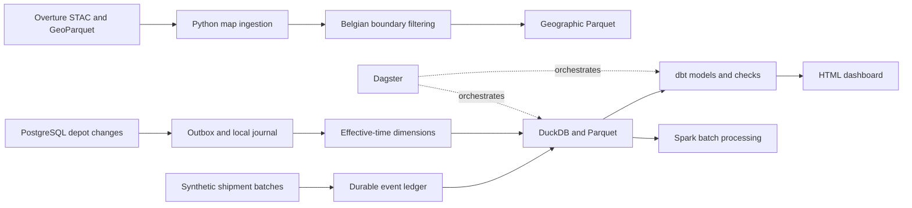

# BelgiFlow

BelgiFlow is a Belgium-focused batch data platform for exploring how a logistics company could ingest, reconcile, and analyze operational and geographic data. It combines real Overture map features with deterministic synthetic shipments and fictional depot policies.

The project is intended for data engineering practice and continued personal development. It has no AI features, real customers, driver tracking, or real delivery records.

## What works

- Release-pinned Overture acquisition using STAC file extents, bounded remote queries, checksums, and cached metadata.
- Real Belgian country-boundary extraction and exact geometry clipping.
- Independently downloaded building, road-segment, and connector samples near Brussels.
- Durable incremental event ingestion, revision handling, quarantine, replay, and checksum-verified publication.
- PostgreSQL transactional outbox with per-change acknowledgements that tolerate transactions committing out of ID order.
- Effective-time depot history and historical service-radius coverage checks.
- Parquet outputs, DuckDB warehouse, dbt shipment and depot models, and reconciliation tests.
- A Dagster workflow that runs operations, builds and tests dbt models, then publishes an HTML dashboard.
- A separate Spark batch pipeline that reads the operational Parquet output or generates a larger synthetic workload.
- Optional Docker packaging and Terraform configuration for AWS storage and an on-demand Fargate task.

National Belgian downloads are configurable but have not been executed or scale-validated. Actual live validation used a small Brussels area and the national boundary. AWS resources have not been provisioned. Kubernetes and distributed spatial processing are deferred.

## Quickstart

Use Python 3.12 and run commands from the repository root. Create and activate a virtual environment first, or use uv.

```bash
uv sync --frozen --extra dev --extra analytics --extra orchestration --extra postgres
uv run --no-sync python -m belgiflow.cli --full-demo --shipments 1000
uv run --no-sync python scripts/verify_dagster.py
```

The first command downloads dependencies. The two demo commands then work without AWS or external map access. The Dagster verification runs dbt and publishes its mart results to the dashboard.

Alternatively, install the locked runtime with pip, followed by the local package and test tools:

```bash
pip install -r requirements.lock.txt
pip install -e . --no-deps
pip install pytest==9.2.0
python scripts/verify_dagster.py
```

Open `data/dashboard/index.html` in your browser. It has a depot filter, synthetic operational metrics, and a Belgian outline when the real boundary has been downloaded. Without that download, the offline demo intentionally shows depot points without claiming a real country outline.

For the Dagster development interface:

```bash
dagster dev -m belgiflow.definitions
```

Run the `offline_operations` job. The daily schedule uses Europe/Brussels time. A single local writer should own the warehouse and publication directory.

## Download real Belgian map data

```bash
python -m belgiflow.cli --refresh-map demo --release 2026-10-21.0 --full-demo
```

Omit `--release` to discover a current release once for that run. A release can disappear from the provider's retention window. If so, choose an available release and record that change.

The command retrieves the Belgian land boundary, then a small Brussels sample of buildings, transportation segments, and connectors. Raw inputs keep their acquisition envelope. Silver outputs are clipped against the exact national polygon.

The `belgium` profile requests the national acquisition envelope. It is a larger experimental workload, not a demonstrated national deployment. It can exceed local resources or the five-minute query deadline. Start with the demo and read [the runbook](docs/RUNBOOK.md) before increasing scope.

No API key or AWS account is required for public-source access. The first run needs internet access for STAC metadata, Parquet range requests, and DuckDB's official httpfs extension.

## PostgreSQL change capture

```bash
docker compose up -d postgres
```

The database is disposable development infrastructure with trust authentication and a localhost-only published port. Do not use this configuration on a shared or publicly accessible machine.

Set `BELGIFLOW_DSN` to the local connection string shown in `.env.example`. Environment files are examples only and are not loaded automatically.

```python
import os
from belgiflow.cdc import seed_demo
seed_demo(os.environ['BELGIFLOW_DSN'])
```

The Dagster operational asset consumes that source when the variable is set. Without it, the offline workflow uses invented versioned policies directly. Each consumer needs a persistent journal paired with its own acknowledgement identity. Do not delete a journal while retaining its source acknowledgements.

## Spark

A Docker-based Spark runtime avoids requiring Java on the host. From a POSIX shell:

```bash
docker run --rm --user root -v "$PWD/jobs:/jobs:ro" -v "$PWD/data:/data" apache/spark:3.5.3 /opt/spark/bin/spark-submit /jobs/spark_events.py --input /data/silver/events.parquet --shipments 1000 --output /data/spark
```

On PowerShell, replace the volume paths with absolute Windows paths. For a larger independent workload, omit `--input` and use `--shipments 100000`. Results are synthetic. A local two-worker run is not evidence of cluster-scale performance.

## Architecture



Map features provide geographic context. They do not establish real traffic, travel times, demand, or shipment movement. Operational coverage currently uses synthetic depot policies and projected straight-line distances, not road routing.

## Verification and limits

See [the verification report](docs/VERIFICATION.md), [data contracts](docs/DATA_DICTIONARY.md), [sources](docs/SOURCES.md), [runbook](docs/RUNBOOK.md), and [roadmap](ROADMAP.md).

The GitHub workflow is configured but has not run on GitHub because this repository has not been published. Local checks are reported separately. This is a tested local project, not a production-ready logistics system.

## License

Original code is MIT licensed, copyright Adel (Adelapt98). Overture-derived datasets retain their applicable source licenses. They are excluded from Git and are not relicensed under MIT. See [source attribution](docs/SOURCES.md).
