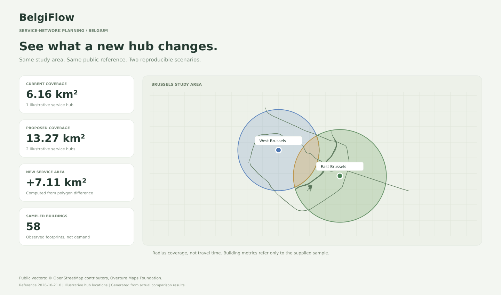
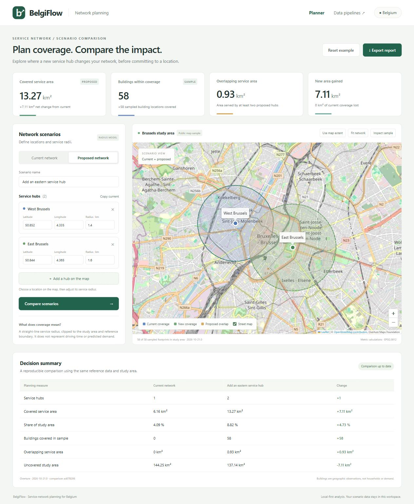
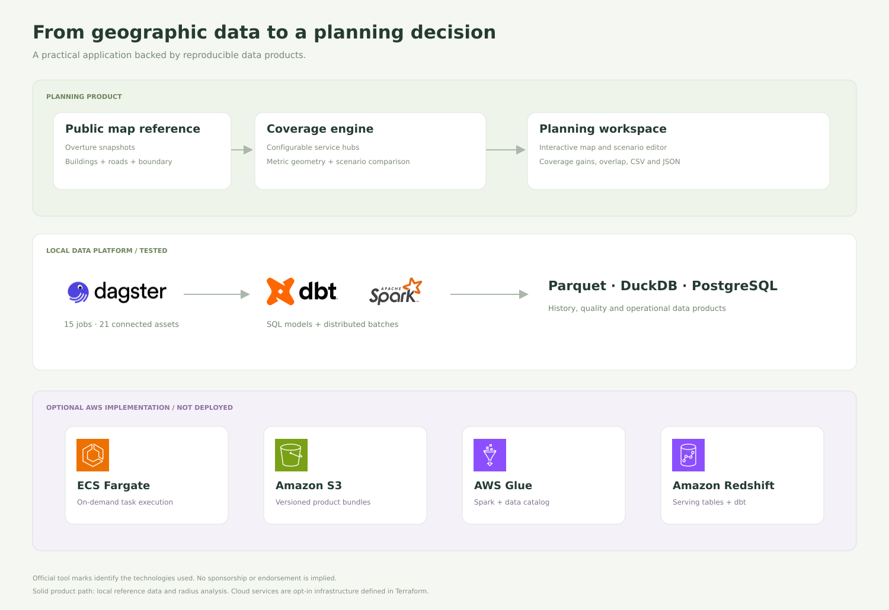
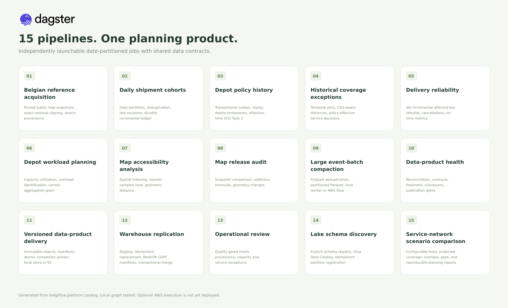

# BelgiFlow

**Compare service-hub networks across Belgium before choosing where to expand.**

BelgiFlow turns public map data into a local service-network planning workspace. Define current and proposed hubs, adjust their service radii, select a study area, and compare coverage gains, gaps, overlaps, and the sampled buildings reached by each option. Export the comparison as CSV or JSON with its inputs and geographic provenance.



The example above uses a real Belgian boundary and a small public Brussels map sample. Adding the fictional eastern hub increases radius coverage from **6.16 to 13.27 km²**, gaining **7.11 km²** and reaching **58 sampled building footprints**. These are computed results, not a production customer case.

## Use the planning workspace

1. Enter your current hubs and their radius in kilometres.
2. Edit the proposed network or add a hub by clicking the map.
3. Choose a study area from the map and compare scenarios.
4. Inspect newly covered areas, overlap, uncovered space, and sampled buildings.
5. Download the report to review or reproduce the same analysis.

Coverage uses metric straight-line radii, not road travel times. Sampled buildings are map footprints, not households, customers, or estimates of demand. A limited sample cannot establish complete building coverage across Belgium.

<details>
<summary>See the actual planning interface</summary>



[Inspecting the building sample](docs/assets/planner-sample.jpg) shows a smaller user-selected study area, so its area totals differ from the default example.

</details>

## Run locally

Use Python 3.12. Install the locked runtime and the project:

```bash
pip install -r requirements.lock.txt
pip install -e . --no-deps
python -m belgiflow.planner.server --source-mode fixtures
```

Open [the planner](http://localhost:8080). The offline fixture mode is clearly labeled and requires no account or API key. To acquire real public geography and use the cached reference instead:

```bash
python -m belgiflow.platform.cli run --pipeline 01_geographic_reference --date 2026-01-03 --source-mode live --release 2026-10-21.0
python -m belgiflow.planner.server --source-mode cached
```

If the release is no longer retained, omit the release argument to discover one current release. See [sources and acquisition](docs/SOURCES.md) and [planner inputs and exports](docs/PLANNER.md).

With the public cache prepared, Docker Desktop can run both interfaces and the separate Spark worker:

```bash
docker compose --profile ui up -d --build planner dagster spark-worker
```

Open [planning on port 8080](http://localhost:8080) and [Dagster on port 3000](http://localhost:3000). On a fresh offline checkout, use the Python fixture command above or change the planner service source mode to `fixtures` before starting it. The local Compose services use root for Windows bind-mount compatibility. No Docker socket is mounted.

## Data platform behind the product

The planning workspace is the main user interface. Fifteen independently launchable Dagster jobs support map acquisition, reproducible planning reports, data quality, and operational scenario analysis. Synthetic shipment workflows provide a separate way to exercise the platform without customer or driver records.



Local execution uses Python, SQL, Parquet, DuckDB, SQLite, dbt, Dagster, and a separate PySpark worker. PostgreSQL provides an optional transactional outbox. The optional AWS path includes S3, Glue, Redshift Serverless, ECS, CloudWatch, IAM, and Terraform. **AWS resources have not been deployed or verified live.**



| Job | Main output | Engineering focus |
| --- | --- | --- |
| `01_geographic_reference` | Pinned geographic reference and clipped map features | Source provenance, release pinning, geometry validation |
| `02_daily_shipment_ingestion` | Accepted daily shipment event cohort | Partitions, incremental ledger, deduplication, late revisions |
| `03_depot_cdc_history` | Historical depot policies | Transactional outbox, replay, delete tombstones, SCD Type 2 |
| `04_service_coverage` | Shipment-level coverage exceptions | Temporal policy joins, projected distances |
| `05_delivery_sla` | Shipment facts and SLA marts | dbt affected-key incremental rebuilds and relational tests |
| `06_depot_capacity` | Depot utilization and excess workload | Aggregation grain, historical capacity |
| `07_building_accessibility` | Building distance to sampled roads | Spatial indexing and nearest geometry |
| `08_map_change_audit` | Added, removed, changed feature IDs | Snapshot comparison, explicit change provenance |
| `09_spark_compaction` | Distributed compacted event files | PySpark, partitioned Parquet, distributed reconciliation |
| `10_quality_observability` | Quality and freshness reports | Contracts, checksums, cross-product reconciliation |
| `11_lake_publication` | Immutable data-product bundle | S3 or local storage, manifests, completion pointers |
| `12_warehouse_replication` | Serving warehouse and tested dbt models | Transactional staging and replacement, Redshift COPY |
| `13_operations_dashboard` | Operational review dashboard | Quality-gated business metrics and provenance |
| `14_catalog_registration` | Registered event schema and partition | Local schema registry or AWS Glue Data Catalog |

| `15_network_planning` | Reproducible hub-network comparison and exports | Projected geometry, overlap, source fingerprints |

Jobs include upstream dependencies. Choose a date partition such as `2026-01-03` in Dagster. `15_network_planning` uses the same comparison engine as the app. `13_operations_dashboard` produces the supporting operational report. `full_platform_demo` runs the whole graph and requires the Spark worker.

```bash
python -m belgiflow.platform.cli list
python -m belgiflow.platform.cli run --pipeline 15_network_planning --date 2026-01-03 --source-mode fixtures
```

Outputs are date-partitioned under `data/platform/partitions/`. The shared local warehouse deliberately serializes writers. See [pipeline contracts](docs/PIPELINES.md), [operations runbook](docs/RUNBOOK.md), and [optional AWS preparation](docs/AWS.md).

## Status and continued development

The local planner, comparison exports, public-map sample, Dagster jobs, dbt transformations, PostgreSQL CDC, and separate Spark worker have been exercised locally. Cloud adapters have offline contract checks. National-scale acquisition, routing, real demand estimation, production deployment, and production users are not claimed.

The [roadmap](ROADMAP.md) prioritizes fuller geographic coverage, better scenario decisions, reliability, and authorized cloud validation. The architecture can also be studied as a practical data engineering reference, but the product goal is useful geographic network comparison.

```bash
pip install pytest==9.2.0
python -m pytest tests -q
python scripts/verify_dagster.py
```

The PostgreSQL integration test requires `BELGIFLOW_TEST_DSN` pointing to a separate disposable test database. It truncates project tables there. SDK-stub tests do not contact AWS. See the [verification record](docs/VERIFICATION.md). GitHub CI is configured but has not run remotely because the repository has not been published.

## Ownership, data and assets

Created and personally maintained by Adel (Adelapt98). The product contains no AI functionality. Operational records are synthetic and public-map features are not customer records.

Original software is [MIT licensed](LICENSE). Public datasets retain their own licenses and attribution requirements. Third-party logos and Leaflet retain their respective rights and licenses, described in [asset credits](docs/assets/ASSETS.md). Tool logos identify integrations and do not imply endorsement. Downloaded datasets, credentials, private configuration, and generated runtime outputs are excluded from Git.
